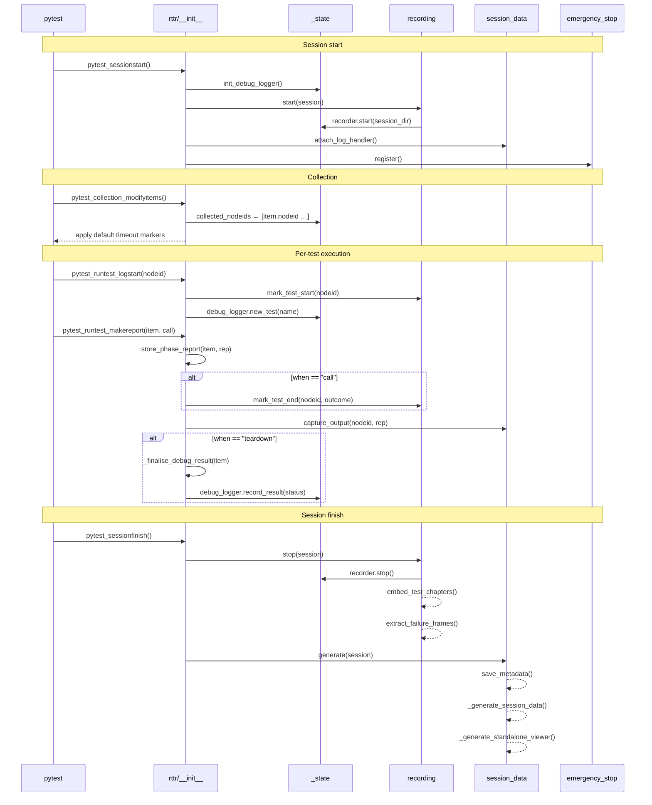
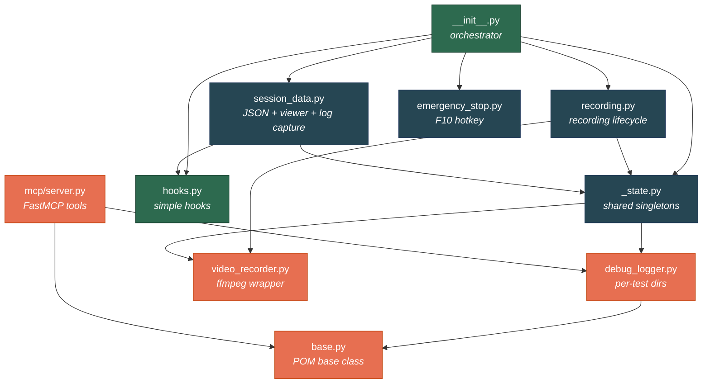
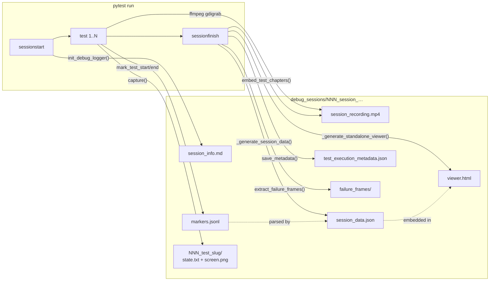

# RTTR — Release The T-Rex 🦖

**RTTR** is a **GUI testing framework** for Windows desktop applications. It
provides the infrastructure needed to write, run, and debug automated UI tests
against real application windows — with full visual traceability.

Built on top of **pywinauto** (UIA backend) and **pytest**, RTTR gives you:

- A **Page Object Model (POM) base class** with typed element finders, wait helpers, and scoped containers
- An **MCP server** that lets AI agents inspect and interact with live application UIs
- **Screen recording** of every test session (ffmpeg), with per-test chapter markers and frame extraction on failure
- **Debug logging** with per-test directories containing UI tree dumps and screenshots
- A **session viewer** (standalone HTML) for replaying test runs in the browser, correlated with video
- **Emergency stop** (F10) to abort test runs safely

RTTR is designed to be **application-agnostic**: the MCP server and POM base
class are parameterized, so you bring your own application class and POM
hierarchy. The framework handles the lifecycle, recording, debugging, and
tooling around it.

---

## Quick start

Register the RTTR pytest plugin in your `conftest.py`:

```python
pytest_plugins = ["rttr"]
```

Create your application POM by extending `rttr.base.BaseModel`:

```python
from rttr.base import BaseModel

class MyApp(BaseModel):
    def __init__(self) -> None:
        super().__init__(element=self.find_top_level_window("My Application"))
```

Write tests using the built-in `debug_logger` fixture:

```python
def test_button_click(app: MyApp, debug_logger):
    button = app.find_element(control_type="Button", title="Submit")
    app.click(button)
    assert app.find_element(control_type="Text", title="Success").exists()
```

## Feature map

| Feature | Module | Description |
|---|---|---|
| **POM base class** | `base.py` | `BaseModel` with `find_element()`, `click()`, `wait_visible()`, `wait_enabled()`, `dump_state()`, and more. |
| **Screen recording** | `recording.py`, `video_recorder.py` | Records the desktop via ffmpeg (2 FPS, H.264). Each test gets a chapter marker in the MP4. |
| **Failure frames** | `video_recorder.py` | Extracts PNG frames around failed tests for visual diagnosis. |
| **Debug logger** | `debug_logger.py` | Creates per-session and per-test directories with UI tree dumps and screenshots. |
| **Session data** | `session_data.py` | Collects all session data — test results, tracebacks, captured output, video-synced log entries — into `session_data.json` and a standalone `viewer.html`. |
| **Emergency stop** | `emergency_stop.py` | Binds F10 to interrupt the main thread (abort after current test). |
| **MCP server** | `mcp/server.py` | Generic UI automation MCP server, parameterized via `RTTR_APP_MODULE`. |
| **POM worker** | `mcp/pom_worker.py` | Ephemeral subprocess that imports all POMs once and executes method calls. |

### Public API

| Symbol | Module | Description |
|---|---|---|
| `BaseModel` | `rttr.base` | Base class for all Page Object Models. |
| `DebugLogger` | `rttr.debug_logger` | Per-session/per-test debug artifact manager. |
| `phase_report_key` | `rttr` | StashKey for accessing per-phase test reports in fixtures. |
| `debug_logger` fixture | `rttr` | Session-scoped fixture returning the `DebugLogger`. |

Everything else (hooks, recording, session_data, emergency_stop, _state) is
**internal plumbing** — used by the plugin hooks but not intended for direct
import by test code.

## Package layout

```
rttr/                       ← project directory
  rttr/                     ← importable Python package
    __init__.py             ← orchestrator: composite hooks + debug_logger fixture
    _state.py               ← shared singletons (recorder, debug_logger, etc.)
    base.py                 ← BaseModel for POM classes (pywinauto abstraction)
    debug_logger.py         ← DebugLogger: per-session/per-test debug folders
    emergency_stop.py       ← F10 hotkey → interrupt_main (internal)
    hooks.py                ← simple hooks: CLI options, collection, phase reports (internal)
    recording.py            ← screen recording lifecycle orchestration (internal)
    session_data.py         ← session_data.json + viewer + log capture (internal)
    video_recorder.py       ← SessionRecorder (ffmpeg), chapter embedding, frame extraction
    mcp/
      __init__.py
      server.py             ← FastMCP UI automation server
      pom_worker.py         ← ephemeral POM subprocess worker
  tests/                    ← full test suite (unit + integration)
    conftest.py             ← state isolation fixtures
    test_state.py
    test_hooks.py
    test_recording.py
    test_session_data.py    ← also covers log capture (SessionLogHandler)
    test_debug_logger.py
    test_video_recorder.py
    test_logging_handler.py ← SessionLogHandler + attach_log_handler
    test_emergency_stop.py
    test_plugin_integration.py  ← pytester-based integration tests
```

## Architecture

The `__init__.py` module acts as the **orchestrator**: it imports simple hooks
from `hooks.py` and defines composite hooks that delegate to multiple
sub-modules in the correct order.

Shared state (recorder, debug_logger, collected_nodeids, etc.) lives in
`_state.py` to avoid circular imports between sub-modules.

### Hook lifecycle



### Module dependency graph



### Session artifact flow



```
pytest lifecycle          RTTR hooks
─────────────────         ──────────────────────────
sessionstart        →     init debug_logger, start recorder, attach log capture, bind F10
collection          →     record nodeids, apply default timeouts
runtest_logstart    →     emit video marker, create per-test debug dir
runtest_makereport  →     stash phase report, emit video marker, capture output, finalise debug result
sessionfinish       →     stop recorder, embed chapters, extract failure frames, generate session_data.json
```

## CLI options

| Option | Default | Description |
|---|---|---|
| `--no-record` | `False` | Disable ffmpeg screen recording for this session. |

## Session artifacts

After a test run, the debug session folder contains:

```
debug_sessions/NNN_session_TIMESTAMP/
  session_info.md                        ← human-readable summary
  session_recording.mp4                  ← desktop video (with chapter markers per test)
  session_recording_markers.jsonl        ← test ↔ video timestamp mapping
  session_data.json                      ← machine-readable session data
  viewer.html                            ← standalone browser viewer
  test_execution_metadata.json           ← seed, counts, failed tests
  ffmpeg_stderr.log                      ← ffmpeg diagnostic output
  NNN_test_<slug>/                       ← per-test debug directory (discarded on pass)
    NNN_<label>/
      state.txt                          ← full UI tree text dump
      screen.png                         ← full-screen screenshot
  failure_frames/                        ← auto-extracted frames for failed tests
    <test_slug>/
      frame_0001.png
      frame_0002.png
```

## Running the tests

```bash
python -m pytest rttr/tests/ -q -p no:rttr --timeout=30
```

Use `-p no:rttr` because the rttr plugin is the **system under test**, not a
runtime dependency for its own test suite.

With coverage:

```bash
python -m pytest rttr/tests/ -q -p no:rttr --timeout=60 --cov=rttr/rttr --cov-report=term-missing
```

## Configuration

RTTR is configured via `pyproject.toml`:

```toml
[tool.poetry]
packages = [
    { include = "rttr", from = "rttr" },
]
```

The MCP server is parameterized via the `RTTR_APP_MODULE` environment variable,
which specifies the fully-qualified path to the application class (e.g.
`motionlab_integration_tests.pom.app:MotionLabApp`).
