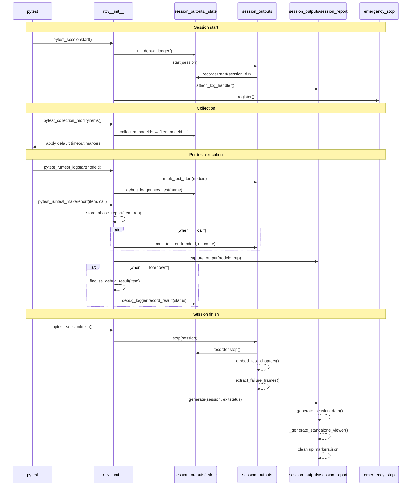

# RTTR — Release The T-Rex 🦖

**RTTR** is a **GUI testing framework** for Windows desktop applications. It
provides the infrastructure needed to write, run, and debug automated UI tests
against real application windows — with full visual traceability.

Built on top of **pywinauto** (UIA backend) and **pytest**, RTTR gives you:

- A **Page Object Model (POM) base class** with typed element finders, wait helpers, and scoped containers
- An **MCP server** that lets AI agents inspect and interact with live application UIs
- **Screen recording** of every test session (ffmpeg), with per-test chapter markers and frame extraction on failure
- **Debug logging** with per-test directories containing UI tree dumps and screenshots
- A **session viewer** (standalone HTML) for replaying test runs in the browser, correlated with video
- **Emergency stop** (F10) to abort test runs safely

RTTR is designed to be **application-agnostic**: the POM base class, pytest
plugin, and MCP server are generic — you bring your own application class and
POM hierarchy. The framework handles the lifecycle, recording, debugging, and
tooling around it.

---

## Quick start

Install RTTR as a dependency in your test project (`pip install -e ../rttr`).
The pytest plugin registers automatically via the `pytest11` entry point — no
manual configuration needed.

Create your application POM by extending `rttr.base.BaseModel`:

```python
from rttr.base import BaseModel


class MyApp(BaseModel):
    def __init__(self) -> None:
        super().__init__(element=self.find_top_level_window("My Application"))
```

Write tests using the built-in `debug_logger` fixture:

```python
def test_button_click(app: MyApp, debug_logger):
    button = app.find_element(control_type="Button", title="Submit")
    app.click(button)
    assert app.find_element(control_type="Text", title="Success").exists()
```

## Feature map

| Feature | Module | Description |
|---|---|---|
| **POM base class** | `base.py` | `BaseModel` with `find_element()`, `click()`, `wait_visible()`, `wait_enabled()`, `dump_state()`, and more. |
| **Screen recording** | `session_outputs/video_recorder.py` | Records the desktop via ffmpeg (2 FPS, H.264). Each test gets a chapter marker in the MP4. |
| **Chapter embedding** | `session_outputs/video_chapters.py` | Embeds per-test chapter markers into the MP4 after recording. |
| **Failure frames** | `session_outputs/test_outputs/failure_frames.py` | Extracts PNG frames around failed tests for visual diagnosis. |
| **Debug logger** | `session_outputs/debug_logger.py` | Creates per-session and per-test directories with UI tree dumps and screenshots. |
| **Session report** | `session_outputs/session_report.py` | Collects all session data — test results, tracebacks, captured output, video-synced log entries — into `session_data.json` and a standalone `viewer.html`. |
| **Session state** | `session_outputs/_state.py` | `SessionState` class encapsulating all mutable session state (recorder, debug_logger, test_outputs, collected_nodeids, log entries). |
| **Typed containers** | `session_outputs/_types.py` | `TestOutput`, `TestResult`, `LogEntry` dataclasses replacing untyped dicts. |
| **Emergency stop** | `emergency_stop.py` | Binds F10 to interrupt the main thread (abort after current test). |
| **MCP server** | `mcp/server.py` | Generic UI automation MCP server, parameterized via `RTTR_APP_MODULE`. |
| **POM worker** | `mcp/pom_worker.py` | Ephemeral subprocess that imports all POMs once and executes method calls. |

### Public API

| Symbol | Module | Description |
|---|---|---|
| `BaseModel` | `rttr.base` | Base class for all Page Object Models. |
| `DebugLogger` | `rttr.session_outputs.debug_logger` | Per-session/per-test debug artifact manager. |
| `TestOutput` | `rttr.session_outputs._types` | Dataclass for per-test captured output, tracebacks, dumps. |
| `TestResult` | `rttr.session_outputs._types` | Dataclass for test result entries (name, status, duration). |
| `LogEntry` | `rttr.session_outputs._types` | Dataclass for timestamped log records. |
| `phase_report_key` | `rttr` | StashKey for accessing per-phase test reports in fixtures. |
| `debug_logger` fixture | `rttr` | Session-scoped fixture returning the `DebugLogger`. |

Everything else (hooks, session_outputs internals, emergency_stop) is
**internal plumbing** — used by the plugin hooks but not intended for direct
import by test code.

## Architecture

The `__init__.py` module acts as the **orchestrator**: it imports simple hooks
from `hooks.py` and defines composite hooks that delegate to the
`session_outputs` package in the correct order.

All session artifact logic lives in `rttr/session_outputs/`:

```
rttr/session_outputs/
  __init__.py              ← lifecycle functions (start/stop recording, mark tests)
  _state.py                ← SessionState singleton (recorder, debug_logger, test_outputs, etc.)
  _types.py                ← TestOutput, TestResult, LogEntry dataclasses
  _logger.py               ← SessionLogHandler + attach_log_handler()
  video_recorder.py        ← SessionRecorder (ffmpeg screen capture)
  video_chapters.py        ← embed_test_chapters() (post-recording)
  session_report.py        ← generate() → session_data.json + viewer.html
  debug_logger.py          ← DebugLogger (per-session/per-test directories)
  test_outputs/
    failure_frames.py      ← extract_failure_frames() (PNG extraction)
```

Shared state (recorder, debug_logger, collected_nodeids, etc.) lives in
`session_outputs/_state.py` to avoid circular imports between sub-modules.

### Hook lifecycle



```
pytest lifecycle          RTTR hooks
─────────────────         ──────────────────────────
sessionstart        →     init debug_logger, start recorder, attach log capture, bind F10
collection          →     record nodeids, apply default timeouts
runtest_logstart    →     emit video marker, create per-test debug dir
runtest_makereport  →     stash phase report, emit video marker, capture output, finalise debug result
sessionfinish       →     stop recorder, embed chapters, extract failure frames, generate session_data.json + viewer.html
```

## CLI options

| Option | Default | Description |
|---|---|---|
| `--no-record` | `False` | Disable ffmpeg screen recording for this session. |

## Session artifacts

After a test run, the debug session folder contains:

```
debug_sessions/NNN_session_TIMESTAMP/
  session_data.json                      ← machine-readable session data (for AI)
  viewer.html                            ← standalone browser viewer (for humans)
  session_recording.mp4                  ← desktop video (with chapter markers per test)
  NNN_test_<slug>/                       ← per-test debug directory (discarded on pass)
    NNN_<label>/
      state.txt                          ← full UI tree text dump
      screen.png                         ← full-screen screenshot
  failure_frames/                        ← auto-extracted frames for failed tests
    <test_slug>/
      frame_0001.png
      frame_0002.png
```

Intermediate files (`session_recording_markers.jsonl`) are cleaned up
automatically after `session_data.json` is generated.

## Running the self-tests

```bash
python -m pytest tests/ -q --timeout=30
```

The `pyproject.toml` already configures `testpaths = ["tests"]` and
`addopts = "-p no:rttr"` (the rttr plugin is the **system under test**, not a
runtime dependency for its own test suite).

With coverage:

```bash
python -m pytest tests/ -q --timeout=60 --cov=rttr --cov-report=term-missing
```

## Configuration

RTTR is configured via `pyproject.toml`:

```toml
[build-system]
requires = ["setuptools>=75.0"]
build-backend = "setuptools.build_meta"

[tool.setuptools]
packages = ["rttr", "rttr.mcp", "rttr.session_outputs", "rttr.session_outputs.test_outputs"]
```

The MCP server is parameterized via the `RTTR_APP_MODULE` environment variable,
which specifies the fully-qualified path to the application class (e.g.
`my_tests.pom.app:MyApp`).  The MCP server name defaults to `RTTR_MCP` and can
be overridden with the `RTTR_MCP_NAME` env var.
